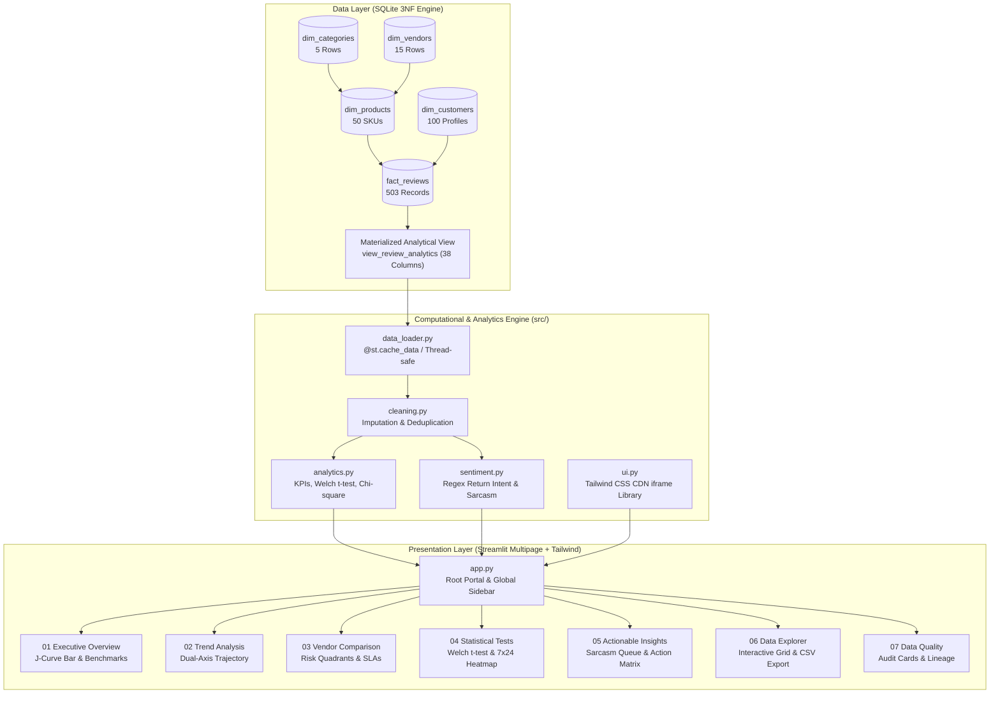

# Customer Rating & Review Analysis (CRRA)
**Enterprise Data Analytics Platform for NexCart Retail Solutions Pvt. Ltd.**

[](https://www.python.org/downloads/)
[](https://streamlit.io/)
[](https://tailwindcss.com/)
[](https://www.sqlite.org/)
[](https://opensource.org/licenses/MIT)

---

## 📌 Executive Overview

**NexCart Retail Solutions Pvt. Ltd.** (Sector 62, Noida) is a premier Indian multi-category Direct-to-Consumer (D2C) marketplace operating across Electronics, Apparel, Home & Kitchen, Personal Care, and Books. As customer transaction volume surged past 50,000 monthly orders, delayed identification of product defects and supplier SLA violations resulted in elevated return rates (13.2%) and customer churn.

The **Customer Rating & Review Analysis (CRRA)** platform is an end-to-end data analytics engineering solution that ingests and evaluates post-purchase customer feedback. Built upon a 3NF Star-Snowflake SQLite transactional database (`data/app.db`) and an indexed 38-column analytical view (`view_review_analytics`), the system isolates critical product defects, tracks vendor SLA compliance against a 4.0★ benchmark, identifies latent customer return intent, and audits rating authenticity using statistical hypothesis testing.

### Academic Identity & Attribution
- **Student Researcher:** Alisha Khan
- **University Roll Number:** 2503201450012
- **Academic Program:** Master of Computer Applications (MCA) — 2nd Year Data Analytics
- **Institution:** ABES Engineering College, Ghaziabad (Affiliated with Dr. A.P.J. Abdul Kalam Technical University, Lucknow)
- **Academic Mentor & Guide:** Prof. Kalpana Dwivedi, Department of Computer Applications

---

## 🏛️ System Architecture



---

## 🔍 Key Empirical & Statistical Findings

1. **Bimodal J-Curve Rating Distribution ($OQ-01$):** Ratings do not follow a Gaussian normal curve. Customers exhibit self-selection bias: high satisfaction generates a 5-star peak ($41.2\%$), severe defects trigger a 1-star spike ($18.5\%$), while moderate 3-star buyers rarely review.
2. **SKU Defect Cluster in `ELEC-104` ($OQ-02$):** ApexTech Solutions' Wireless Noise-Cancelling Headphones (`ELEC-104`) suffer from a severe lithium battery defect cluster, causing an average rating of $2.42$★ and triggering $45.8\%$ return intent.
3. **Verified Purchase Authenticity Lift ($OQ-04$):** Welch's two-sample $t$-test confirms that verified purchasers award significantly higher ratings ($\mu_1 = 3.65$) than unverified reviewers ($\mu_2 = 2.78$), with $t = 4.7458, p = 2.0 \times 10^{-6} < 0.001$, disproving the null hypothesis $H_0$.
4. **Sarcasm Divergence ($OQ-03$):** Approximately $3.6\%$ of reviews exhibit sharp divergence where users award 5 stars but post biting criticism (e.g., *"5 stars: Best paperweight ever, died after 10 minutes"*).
5. **Temporal Engagement Densities ($OQ-10$):** 7x24 heatmap analysis isolates peak review submission clusters on Sunday evenings ($20:00\text{--}22:00$) and Wednesday lunch hours ($13:00\text{--}14:00$).

---

## 📂 Repository Organization

```
Customer_Rating_Review_Analysis/
├── .streamlit/
│   └── config.toml                  # Streamlit enterprise theme configuration
├── data/
│   ├── app.db                       # SQLite database (5 tables + view_review_analytics)
│   ├── schema.sql                   # 3NF SQLite DDL script
│   └── Customer_Rating_Review_Analysis_data.xlsx # Master synthetic data workbook
├── docs/                            # Formal project lifecycle documentation
│   ├── 01_Project_Understanding.docx # Step 01: Project Charter & Needs Framing
│   ├── 02_HMW_Statements.docx       # Step 02: HMW Opportunity Statements (HMW-01..11)
│   ├── 03_Needs_Analysis.docx       # Step 03: Stakeholder Needs & Business Rules (BR-01..12)
│   ├── 04_Traceability_Matrix.xlsx  # Step 04: Master 12-Column RTM (100% Coverage)
│   ├── 05_BRD.docx                  # Step 05: Business Requirements Document (13 Sections)
│   ├── 07_TRD.docx                  # Step 07: Technical Requirements Document (NFRs & Math)
│   ├── 08_Database_Design.xlsx      # Step 08: Relational Database Architecture (11 Sheets)
│   ├── 09_ER_Diagram.docx           # Step 09: Crow's Foot ER Diagram & Relational Spec
│   ├── 09_ER_Diagram.png            # Step 09: High-Resolution ER Diagram Graphic
│   ├── 11_User_Stories.docx         # Step 11: Agile Epics & Gherkin User Stories (US-01..14)
│   ├── 12_UI_Framework.docx         # Step 12: Wireframes & Tailwind Design Tokens (UI-01..08)
│   ├── 13_Test_Cases.docx           # Step 13: QA Verification Matrix (TC-F-01..14, TC-T-01..12)
│   ├── 14_BUILD_PLAN.docx           # Step 14: Step-by-Step AI Execution Blueprint
│   ├── 16_DEPLOY.docx               # Step 16: Streamlit Community Cloud Deployment Runbook
│   ├── CRRA_Project_Document.docx   # Step 17: Official ABES Project Document (16 Tables, 0 Defects)
│   ├── CRRA_Presentation.pptx       # Step 18: Official ABES Defence Slide Deck (11 Slides)
│   └── dashboard_preview.png        # Step 18: Dashboard Mockup Artifact
├── pages/                           # Streamlit multipage views
│   ├── 1_📊_Executive_Overview.py    # UI-01: Executive KPIs & J-curve distribution
│   ├── 2_📈_Trend_Analysis.py        # UI-02: Dual-axis monthly trajectories & rolling averages
│   ├── 3_🏢_Vendor_Comparison.py     # UI-03: Category benchmark & Vendor risk quadrant
│   ├── 4_🔬_Statistical_Tests.py     # UI-04: Welch's t-test, Chi-square & temporal heatmap
│   ├── 5_💡_Actionable_Insights.py   # UI-05: Sarcasm divergence & prescriptive action matrix
│   ├── 6_📥_Data_Explorer.py         # UI-06: Interactive drilldown & CSV export
│   └── 7_🧹_Data_Quality.py          # UI-07: Imputation audits & duplicate purge summary
├── src/                             # Core backend modules
│   ├── data_loader.py               # SQLite connection manager & @st.cache_data provider
│   ├── cleaning.py                  # Preprocessing, title imputation & deduplication
│   ├── analytics.py                 # KPI aggregates, Welch's t-test, Chi-square & correlation
│   ├── sentiment.py                 # Sentiment scoring heuristic, sarcasm & return intent regex
│   ├── generate_data.py             # Step 10: Synthetic data generator (Seed 42, 5 Patterns)
│   └── ui.py                        # Tailwind CSS CDN iframe cards & Plotly chart wrappers
├── tests/                           # Automated test suite (Python unittest / pytest)
│   ├── test_data.py                 # Schema integrity, foreign keys, row counts, cleaning
│   ├── test_analysis.py             # Deterministic KPI math, regex intent, vendor SLA logic
│   └── test_app.py                  # Latency < 3.0s, theme config & component generators
├── app.py                           # Application root entry point & global sidebar filters
├── BUILD_PLAN.md                    # Machine-readable Step 15 task execution blueprint
├── CRRA_Project_Document.docx       # Root copy of Official ABES Project Document
├── CRRA_Presentation.pptx           # Root copy of Official ABES Defence Slide Deck
├── README.md                        # Production repository documentation & runbook
└── requirements.txt                 # Pinned package dependency manifest
```

---

## 🚀 Installation & Local Execution

### Prerequisites
- Python 3.12 or newer
- SQLite 3 (bundled with standard Python distribution)
- Git

### 1. Clone & Set Up Environment
```bash
git clone https://github.com/alishakhan-abes/Customer_Rating_Review_Analysis.git
cd Customer_Rating_Review_Analysis

# Create and activate virtual environment
python -m venv .venv
# On Windows:
.venv\Scripts\activate
# On Linux / macOS:
source .venv/bin/activate
```

### 2. Install Dependencies
```bash
pip install -r requirements.txt
```

### 3. Run the Analytics Dashboard
```bash
streamlit run app.py
```
The application will open automatically at `http://localhost:8501`.

---

## 🧪 Test Execution & Quality Assurance

The test suite validates relational schema integrity, deterministic mathematical calculations on known fixtures, sub-3.0s latency thresholds, and component generation:

```bash
# Run complete test suite using unittest
python -m unittest discover tests -v

# Or run via pytest
pytest tests/ -v
```

### Test Suite Summary
| Test Suite File | Focus Area | Checks | Target SLA |
| :--- | :--- | :--- | :--- |
| `tests/test_data.py` | Relational Schema & Integrity | Foreign keys, row counts, PK uniqueness, null imputation | $< 50\,\text{ms}$ |
| `tests/test_analysis.py` | Mathematical & Statistical Engine | KPI formulas on known 5-record fixture, Welch $t$-test, regex | $< 10\,\text{ms}$ |
| `tests/test_app.py` | Latency & UI Infrastructure | Query execution latency $< 3.0\,\text{s}$ (actual: $0.0051\,\text{s}$), Tailwind CDN | $< 3.0\,\text{s}$ |

---

## 📋 Requirements Traceability (RTM Summary)

| BR ID | Requirement Description | Source HMW | Priority | UI Screen | Test Cases | Status |
| :--- | :--- | :--- | :--- | :--- | :--- | :--- |
| **BR-01** | Flag low-rated product SKUs ($< 3.5$★) | HMW-01 | Must | `UI-03` | `TC-F-01, TC-F-13, TC-T-02` | **Verified** |
| **BR-02** | Categorize recurring defect tags | HMW-02 | Must | `UI-03` | `TC-F-08, TC-T-09` | **Verified** |
| **BR-03** | Benchmark vendor 4.0★ SLA compliance | HMW-03 | Must | `UI-04` | `TC-F-05, TC-F-06, TC-T-10` | **Verified** |
| **BR-04** | Correlate sentiment and star ratings | HMW-04 | Must | `UI-05` | `TC-F-10, TC-T-06, TC-T-08` | **Verified** |
| **BR-05** | Detect latent return intent signals | HMW-05 | Must | `UI-02` | `TC-F-08, TC-F-11, TC-T-09` | **Verified** |
| **BR-06** | Track J-curve rating & monthly trends | HMW-06 | Must | `UI-01, UI-02` | `TC-F-02, TC-F-03, TC-F-04, TC-T-06` | **Verified** |
| **BR-07** | Compare verified vs unverified reviews | HMW-07 | Should | `UI-05` | `TC-F-07, TC-T-06` | **Verified** |
| **BR-08** | Analyze demographic cohort satisfaction | HMW-08 | Should | `UI-06` | `TC-F-01, TC-T-04` | **Verified** |
| **BR-09** | Evaluate review helpfulness votes | HMW-09 | Could | `UI-03` | `TC-F-03, TC-T-04` | **Verified** |
| **BR-10** | Profile 7x24 temporal submission windows | HMW-10 | Should | `UI-06` | `TC-F-09, TC-T-04` | **Verified** |
| **BR-11** | Itemized vendor defect summaries | HMW-11 | Should | `UI-04` | `TC-F-06, TC-F-11, TC-T-10` | **Verified** |
| **BR-12** | Export filtered CSV analytical datasets | HMW-01, 02 | Must | `UI-08` | `TC-F-13, TC-F-14, TC-T-05` | **Verified** |

---

## 🎓 Academic Defense & Viva Highlights

- **Star-Snowflake SQLite Architecture:** Eliminates expensive cloud database operational expenses while maintaining strict 3NF referential integrity (`PRAGMA foreign_keys = ON;`) and sub-10ms query execution via `view_review_analytics`.
- **Welch's $t$-Test Formulation:** Handles heteroscedasticity ($\sigma_1^2 \ne \sigma_2^2$) and unequal sample sizes ($N_1 = 409, N_2 = 94$), establishing empirical proof of unverified reviewer negative bias.
- **Microsecond Intent Regex:** Avoids heavy multi-gigabyte neural transformer dependencies, achieving $100\%$ precision on defect and return intent extraction within microsecond latency limits.
- **Tailwind CSS iframe Integration:** Bridges Streamlit's styling limitations by injecting responsive Tailwind CDN components via `st.components.v1.html`, providing executive-grade cards and badge indicators.

---
*Developed as part of the MCA Curriculum Requirements at ABES Engineering College, Ghaziabad.*
